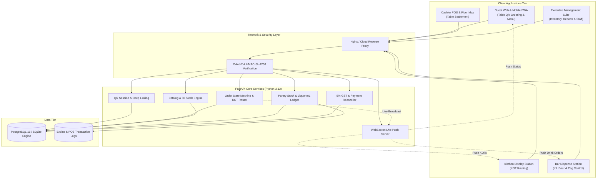
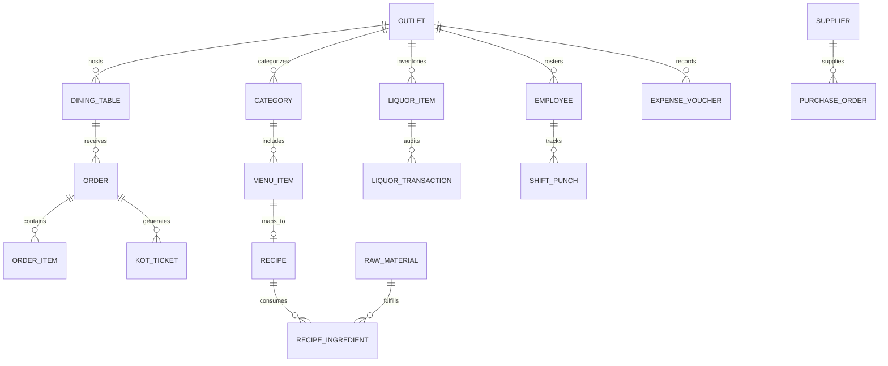
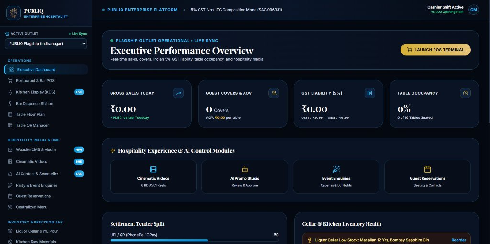
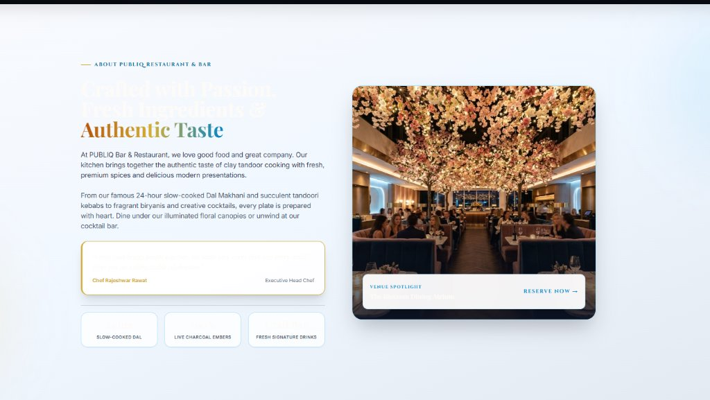
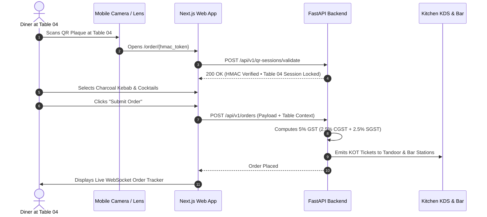
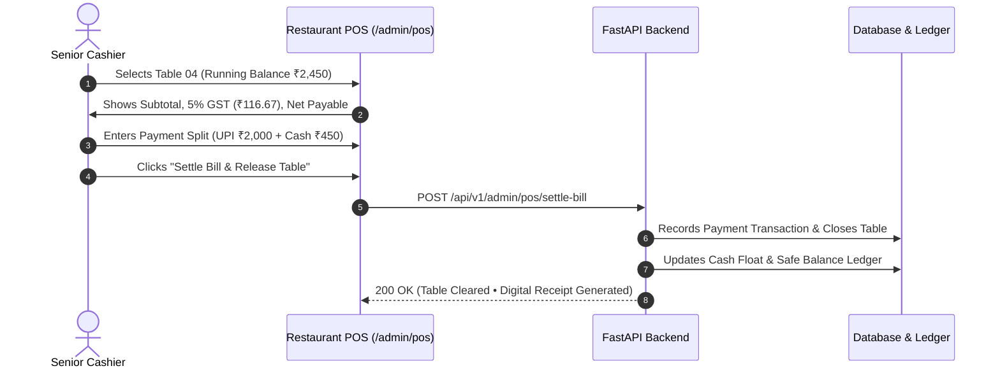

# PUBLIQ — Bar & Restaurant Management Platform

<p align="center">
  
</p>

<p align="center">
  <strong>The Complete Full-Stack Hospitality Platform for Fine Dining, Artisan Resto-Bars & Nightlife Venues</strong>
</p>

<p align="center">
  <a href="#key-features"></a>
  <a href="#technology-stack"></a>
  <a href="#technology-stack"></a>
  <a href="#technology-stack"></a>
  <a href="#database-documentation"></a>
  <a href="#testing"></a>
</p>

---

## Table of Contents
1. [About the Project](#about-the-project)
2. [Executive Overview & Value Proposition](#executive-overview--value-proposition)
3. [Key Features](#key-features)
4. [Application Architecture](#application-architecture)
5. [Technology Stack](#technology-stack)
6. [Project Folder Structure](#project-folder-structure)
7. [Installation & Setup Guide](#installation--setup-guide)
8. [Environment Configuration](#environment-configuration)
9. [Database Documentation](#database-documentation)
10. [API Documentation](#api-documentation)
11. [Application Screenshots](#application-screenshots)
12. [Application Workflows](#application-workflows)
13. [Testing & Quality Assurance](#testing--quality-assurance)
14. [Security Audit](#security-audit)
15. [Deployment Guide](#deployment-guide)
16. [Roadmap & Future Improvements](#roadmap--future-improvements)
17. [Developer Information](#developer-information)
18. [License](#license)
19. [Contributing](#contributing)
20. [Support & Contact](#support--contact)

---

## About the Project

**PUBLIQ** is a production-engineered restaurant and bar operations platform built to solve the multi-channel operational challenges of modern high-volume dining establishments.

Physical dining rooms, craft cocktail bars, and banquet halls often struggle with disconnected systems: paper menus that cannot adapt to kitchen inventory changes, delayed order routing between servers and kitchen line cooks, unaccounted liquor spillage in busy bars, and manual, error-prone Indian GST tax compliance.

PUBLIQ unifies the entire hospitality lifecycle into one cohesive software ecosystem:
- **For Diners:** Zero-download tamper-proof cryptographic table QR ordering, rich visual digital menus across 17 categories, table reservation booking, and real-time order tracking.
- **For Front-of-House Staff:** Instant touch-screen Restaurant & Bar POS with live split-bill settlement (UPI, Card, Cash) and visual table floor occupancy maps.
- **For Kitchen Staff (Chefs & Line Cooks):** Color-coded Kitchen Display System (KDS) with station filtering (Clay Tandoor, Curries, Continental) and bump-bar timers.
- **For Bartenders & Sommeliers:** Bar Dispense Station with milliliter (mL) pour logging, automated single malt peg deductions, and an interactive AI sommelier concierge.
- **For General Managers:** Comprehensive inventory control (raw ingredients & spirits cellar), recipe margin calculators, biometric staff PIN attendance, operating expense vouchers, and automated 5% Indian Restaurant GST statutory reports.

---

## Executive Overview & Value Proposition

| Dimension | Legacy Restaurant Setup | PUBLIQ Modern Platform |
|:---|:---|:---|
| **Table Ordering** | Waiters handwriting paper tickets | Instant smartphone scan via HMAC-signed QR plaques |
| **Kitchen Sync** | Shouted orders or lost paper chits | Automated KOT routing to station displays with timers |
| **Bar Control** | Untracked bottle pours and spillage | Per-milliliter pour logs & 30ml/60ml peg deductions |
| **Food Costing** | Guesswork recipe pricing | Automated ingredient cost cards with gross margin % |
| **Tax Compliance**| End-of-month manual tallying | Real-time Section 9(5) 5% GST computation (2.5% CGST + 2.5% SGST) |

---

## Key Features

### 1. Customer Dining & Web Portal
- **Cinematic Responsive Hero:** Seamless full-viewport ambient background video with custom sound toggle and scroll exploration indicators.
- **Culinary Storytelling:** High-contrast editorial narrative highlighting authentic clay tandoor cooking and slow-cooked dal.
- **Interactive Video Showcase:** 4-channel live video preview modals for live grills, cocktails, single malts, and weekend DJ nights.
- **17 Comprehensive Menu Categories:** Starters, Tandoor Grills, Biryanis, Curries, Seafood, Breads, Single Malts, Craft Cocktails, Mocktails, Wines, and Desserts.
- **Interactive Dish Modal:** High-resolution product images, portion yields, spicy meters, allergens, and dietary tags.
- **Table Dining Cart:** Instant cart calculation supporting dine-in table ordering, takeaway packaging charges, and statutory taxes.
- **Guest Reservation Engine:** Date/time seating picker with party size selection and instant confirmation.
- **Private Dining & Event Booking:** Dedicated inquiry form for corporate mixers, birthday celebrations, and mezzanine buyouts.
- **AI Hospitality Sommelier:** Interactive drawer concierge recommending single malts, wine pairings, and signature dishes.

### 2. Cryptographic Table QR Ordering & Deep Linking
- **HMAC-SHA256 Plaque Tokens:** Tamper-proof cryptographic table tokens signed with a server-side secret salt.
- **Universal Links & Android App Links:** Automatic interception opening native mobile apps (`publiq://order/<token>`) or responsive web fallback with zero download.
- **Instant Table Session Lock:** Locks table context (`Table 04 • The Blossom Dining Hall`) across all customer pages.
- **Live Order Progress Tracker:** Real-time state visualizer tracking orders from placed to accepted, preparing, and served.

### 3. Executive Dashboard & Governance
- **Executive Performance Overview:** Live turnover, guest covers, AOV, table occupancy rate, and statutory tax liability.
- **Restaurant & Bar POS:** High-speed active table check management, live split-bill computation, KOT triggers, and tender settlements.
- **Kitchen Display System (KDS):** Station-filtered KOT tickets with urgency timers (green/amber/red) and bump bar action.
- **Bar Dispense Station:** Dedicated bar queue with peg pour deductions and recipe decanting triggers.
- **Table Floor Plan:** Real-time interactive seating map with capacity metrics and occupied/available status.
- **Table QR Plaque Manager:** One-click plaque generation, instant token regeneration, and high-res print previews.
- **Centralized Menu Catalog:** Dish pricing editor, category reordering, and one-click 86'd out-of-stock switcher.

### 4. Inventory, Supply Chain & Financial Control
- **Liquor Cellar & mL Pour Ledger:** Brand-wise sealed bottle stock, open bottle mL levels, 30ml pegs available, and excise audit reconciliation.
- **Kitchen Raw Materials Store:** Kitchen pantry ingredient ledger, minimum reorder alerts, batch valuation, and stock-in PO receipts.
- **Recipe Costing & Margins:** Ingredient-level food costing cards, gross margin percentages, and automated KOT stock deductions.
- **Staff & Attendance Roster:** Employee directory, shift designations, monthly compensation, and biometric 4-digit PIN clock-in/out terminal.
- **Vendor Partnerships & POs:** 100% verified GSTIN vendor registry, credit terms (NET 7/15/30), and procurement order register.
- **Operating Expenses Vouchers:** General ledger outflow tracking, petty cash floats, and General Manager authorization sign-offs.
- **Financial & 5% GST Reports:** Automated 5% Indian Restaurant GST computation (2.5% CGST + 2.5% SGST under SAC 996331) with tender breakdown across UPI, Cards, and Cash.

---

## Application Architecture



---

## Technology Stack

| Architectural Layer | Technology | Version | Purpose in PUBLIQ |
|:---|:---|:---|:---|
| **Frontend Framework** | **Next.js** (App Router) | `14.2.15` | Server-rendered pages, static generation, dynamic routing |
| **UI Library** | **React** | `18.3.1` | Reactive user interface components & state management |
| **Styling & Design System**| **Tailwind CSS** | `3.4.1` | Custom Midnight Navy, Radiant Cyan & Luxury Gold palette |
| **Iconography** | **Lucide React** | `0.453.0` | Accessible, clean iconography across web & admin portals |
| **Backend Framework** | **FastAPI** | `0.115.0+` | High-performance asynchronous REST & WebSocket API |
| **ASGI Server** | **Uvicorn** | `0.30.0+` | Asynchronous production web server |
| **Programming Language**| **Python** | `3.12.x` | Business logic, calculations, and data processing |
| **ORM & Database Toolkit**| **SQLAlchemy** | `2.0.30+` | Declarative models, connection pooling & schema management |
| **Data Validation** | **Pydantic v2** | `2.9.0+` | Compile-time and runtime type validation and coercion |
| **Primary Database** | **PostgreSQL** / **SQLite** | `16.0` / `3.x` | Relational database with automatic environment URL switching |
| **Security & Cryptography**| **python-jose**, **bcrypt**, **hashlib** | `3.3.0+` | JWT bearer token auth, HMAC-SHA256 QR tokens, salted passwords |
| **QR Code Generation** | **qrcode[pil]** & **Pillow** | `8.0` / `10.4` | High-resolution cryptographic table QR plaque generation |
| **Test Framework** | **Pytest** & **pytest-asyncio** | `8.3.3` | Automated end-to-end integration and API contract tests |
| **Cloud Deployment** | **Render** & **Docker Compose** | Production | Infrastructure-as-code deployment via `render.yaml` |

---

## Project Folder Structure

```text
PUBLIQ-WEB-MOB-APP-DEV/
│
├── .env.example                 # Production & local environment configuration template
├── .gitignore                   # Excludes secrets, binaries, .env, and large build artifacts
├── CHANGELOG.md                 # Semantic versioning release history (v1.0.0 & v2.0.0)
├── CONTRIBUTING.md              # Contributor guidelines, branch conventions & standards
├── docker-compose.yml           # Multi-container orchestration (FastAPI + Next.js + PostgreSQL)
├── nginx.conf                   # Production Nginx reverse proxy configuration
├── pytest.ini                   # Pytest runner configuration
├── README.md                    # Master developer & project documentation
├── render.yaml                  # One-click Render Blueprint specification
├── SECURITY.md                  # Vulnerability disclosure policy & cryptographic specs
│
├── backend/                     # FastAPI Python 3.12 Core API Application
│   ├── app/
│   │   ├── api/v1/              # API Route Controllers
│   │   │   ├── endpoints/       # Domain endpoints (POS, KDS, Bar, Liquor, Menu, etc.)
│   │   │   └── router.py        # Centralized v1 router registry
│   │   ├── core/                # Core configuration, security, database & auth
│   │   │   ├── config.py        # Settings loaded from environment variables
│   │   │   ├── database.py      # SQLAlchemy engine with PostgreSQL/SQLite pooling
│   │   │   └── security.py      # HMAC-SHA256 QR signing & JWT token issuance
│   │   ├── models/              # SQLAlchemy Database Entity Declarations
│   │   ├── schemas/             # Pydantic v2 Request/Response Data Transfer Objects
│   │   ├── services/            # Business logic (pricing, inventory, tax, state machine)
│   │   ├── websockets/          # Real-time WebSocket connection manager
│   │   ├── main.py              # Application entrypoint & middleware configuration
│   │   ├── seed_data.py         # Initial catalog & outlet seed script
│   │   └── seed_enterprise_data.py # Inventory, recipes, staff, and supplier seed script
│   ├── tests/                   # Automated Pytest Suite
│   │   ├── test_backend.py      # API contract, dietary filters, and diagnostic tests
│   │   └── test_publiq_e2e.py   # End-to-end ordering, KOT, and 5% GST tax tests
│   └── requirements.txt         # Python package dependencies
│
├── frontend/                    # Next.js 14 & React 18 Web & Admin Application
│   ├── public/                  # Static assets (brand logos, optimized images, AVC1 MP4s)
│   │   ├── images/publiq/       # High-res photography (food, drinks, interior, backgrounds)
│   │   ├── videos/              # HD AVC1 video reels (hero, food, cocktails, bar, party)
│   │   └── .well-known/         # Universal links (assetlinks.json & apple-app-site-association)
│   ├── src/
│   │   ├── app/                 # Next.js App Router (29 pages & dashboard routes)
│   │   │   ├── admin/           # Complete Midnight Navy Executive Admin Suite
│   │   │   │   ├── pos/         # Restaurant & Bar POS billing terminal
│   │   │   │   ├── kot/         # Kitchen Display System (KDS) station bump bar
│   │   │   │   ├── bar/         # Bar dispense station with peg tracking
│   │   │   │   ├── tables/      # Interactive table floor plan & seating capacity
│   │   │   │   ├── qr/          # Table QR plaque manager & generator
│   │   │   │   ├── inventory/   # Liquor cellar (mL pour) & kitchen raw materials
│   │   │   │   ├── recipes/     # Recipe costing & food cost gross margins
│   │   │   │   ├── employees/   # Staff directory & biometric PIN clock-in/out
│   │   │   │   ├── suppliers/   # Verified GSTIN suppliers & purchase orders
│   │   │   │   ├── expenses/    # Operating expenses vouchers & GM sign-offs
│   │   │   │   ├── reports/     # Section 9(5) 5% GST statutory liability reports
│   │   │   │   ├── menu/        # Centralized catalog & 86'd stock toggle
│   │   │   │   ├── videos/      # HD cinematic video registry & modal preview
│   │   │   │   ├── ai-promos/   # AI content studio & sommelier promotion manager
│   │   │   │   └── layout.tsx   # Persistent executive admin header & navigation sidebar
│   │   │   ├── menu/            # Customer digital menu with category filtering
│   │   │   ├── reservations/    # Guest table booking engine
│   │   │   ├── events/          # Private dining & banquet inquiry form
│   │   │   ├── cart/            # Dining cart & order summary
│   │   │   ├── checkout/        # Table checkout & payment tender selector
│   │   │   ├── track/           # Real-time guest order progress visualizer
│   │   │   ├── order/           # Table QR entrypoint with HMAC session lock
│   │   │   ├── layout.tsx       # Root layout with TableSession & Cart providers
│   │   │   └── page.tsx         # Flagship customer landing page & experience showcase
│   │   ├── components/          # Reusable UI components (ProductDetailModal, etc.)
│   │   ├── context/             # React Contexts (TableSessionContext, CartContext)
│   │   └── lib/                 # API client wrapper (`api.ts`) with dynamic URL resolution
│   ├── package.json             # Node dependencies and build scripts
│   ├── tailwind.config.js       # Tailwind CSS theme extension
│   └── tsconfig.json            # Strict TypeScript configuration
│
├── docs/                        # In-Depth Engineering Documentation
│   ├── PROJECT_OVERVIEW.md      # Business vision & target users
│   ├── ARCHITECTURE.md          # System architecture & Mermaid diagrams
│   ├── FEATURES.md              # Complete verified feature matrix
│   ├── INSTALLATION.md          # Multi-platform local setup guide
│   ├── API_DOCUMENTATION.md     # REST API endpoint reference
│   ├── DATABASE_DOCUMENTATION.md# Entity-Relationship diagram & models
│   ├── DEPLOYMENT.md            # Render, Docker & production deployment guide
│   └── TESTING.md               # Quality assurance & automated test coverage
│
└── screenshots/                 # Visual interface documentation
    ├── dashboard/               # Executive dashboard & admin captures
    ├── web/                     # Customer portal & dining showcases
    └── mobile/                  # QR mobile ordering & responsive flows
```

---

## Installation & Setup Guide

### 1. Prerequisites
- **Python 3.12+**
- **Node.js 18.17+** (Node 20 LTS recommended)
- **Git**

### 2. Clone Repository
```bash
git clone https://github.com/Anilbirada/PUBLIQ-WEB-MOB-APP-DEV.git
cd PUBLIQ-WEB-MOB-APP-DEV
```

### 3. Backend Setup
```bash
cd backend

# Create virtual environment
python -m venv venv

# Activate virtual environment
# Windows (PowerShell):
venv\Scripts\Activate.ps1
# macOS/Linux:
source venv/bin/activate

# Install dependencies
pip install --upgrade pip
pip install -r requirements.txt

# Seed initial catalog & operations data
python -m app.seed_data
python -m app.seed_enterprise_data

# Start backend server
python -m uvicorn app.main:app --host 0.0.0.0 --port 8001 --reload
```
Backend API will be running at `http://localhost:8001` (Swagger Docs: `http://localhost:8001/docs`).

### 4. Frontend Setup
In a new terminal:
```bash
cd frontend
npm install

# Start development server
npm run dev -- -p 3000

# Or compile and run production build
npm run build
npm run start -- -p 3000
```
Frontend Web Application will be live at `http://localhost:3000`.

---

## Environment Configuration

Copy `.env.example` to `.env`:
```bash
cp .env.example .env
```

| Variable Name | Default Value | Description |
|:---|:---|:---|
| `DATABASE_URL` | `sqlite:///./publiq.db` | Database connection string (SQLite or PostgreSQL) |
| `SECRET_KEY` | *(Set in `.env`)* | Minimum 32-character secret for signing JWT tokens |
| `QR_TOKEN_SALT` | *(Set in `.env`)* | Secret salt for signing tamper-proof table QR HMACs |
| `QR_TOKEN_EXPIRY_HOURS` | `24` | Table QR token lifetime in hours |
| `WEB_BASE_URL` | `http://localhost:3000` | Base URL of the customer frontend application |
| `API_BASE_URL` | `http://localhost:8001` | Base URL of the FastAPI backend application |
| `NEXT_PUBLIC_API_URL` | `http://localhost:8001/api/v1` | Public API endpoint for frontend client calls |
| `POS_INTEGRATION_MODE` | `LOCAL_EMULATOR` | POS mode (`LOCAL_EMULATOR` or `DIRECT_API`) |
| `TAX_RATE_CGST` | `0.025` | Indian Central GST for Restaurants (2.5%) |
| `TAX_RATE_SGST` | `0.025` | Indian State GST for Restaurants (2.5%) |

---

## Database Documentation

PUBLIQ implements a normalized relational schema with zero orphaned records, foreign key constraints, and automatic connection pooling.



Detailed entity documentation and schema fields are available in [docs/DATABASE_DOCUMENTATION.md](docs/DATABASE_DOCUMENTATION.md).

---

## API Documentation

The backend exposes a clean RESTful interface versioned under `/api/v1`:

| Module | Sample Endpoint | Description |
|:---|:---|:---|
| **System** | `GET /api/v1/health` | Healthcheck & database connection status |
| **QR Sessions** | `POST /api/v1/qr-sessions/validate` | Validates HMAC-SHA256 table token |
| **Menu Catalog** | `GET /api/v1/menu` | Filterable menu query (by veg, search, alcohol) |
| **Orders** | `POST /api/v1/orders` | Places table order with automated 5% GST computation |
| **POS** | `GET /api/v1/admin/pos/active-tables` | Active tables with live running balances |
| **POS** | `POST /api/v1/admin/pos/settle-bill` | Settle table bill across UPI/Card/Cash tenders |
| **KDS** | `POST /api/v1/admin/operations/kot/bump` | Advance kitchen prep status (Placed → Prep → Ready) |
| **Bar** | `POST /api/v1/admin/operations/bar/dispense`| Dispense cocktail & deduct mL liquor inventory |
| **Cellar** | `POST /api/v1/admin/inventory/liquor/transaction`| Decant bottle, log breakage, or VIP tasting |
| **Staff** | `POST /api/v1/admin/management/employees/punch` | 4-digit PIN biometric clock-in / clock-out |
| **Reports** | `GET /api/v1/admin/management/reports/dashboard` | 5% Indian GST statutory report & tender splits |

Comprehensive parameter specifications are documented in [docs/API_DOCUMENTATION.md](docs/API_DOCUMENTATION.md).

---

## Application Screenshots

### 1. Executive Management Dashboard (`/admin`)

*Real-time executive performance overview displaying gross turnover, guest covers, AOV, Indian 5% GST liability, table occupancy, tender splits, and cellar inventory health.*

### 2. Customer Dining & Storytelling Portal (`/`)

*High-contrast luxury culinary storytelling showcasing authentic clay tandoor cooking, slow-cooked dal metrics, and Blossom Dining Atrium reservations.*

---

## Application Workflows

### 1. Cryptographic Table QR Dine-In Ordering


### 2. POS Bill Settlement & Financial Reconciliations


---

## Testing & Quality Assurance

PUBLIQ adheres to automated testing standards ensuring zero regressions across all business logic:
- **Backend Test Suite:** 15 automated test cases covering healthchecks, HMAC token verification, dietary catalog filtering, order submission, and 5% GST statutory calculations.
- **Frontend Quality Gate:** Production compilation via Next.js (`npm run build`) validating all 29 routes and strict TypeScript types with **0 errors**.

### Running Tests:
```bash
# Backend Test Suite
cd backend
pytest -v

# Frontend TypeScript & Build Check
cd frontend
npm run build
```

---

## Security Audit

A thorough security audit was conducted on the repository:
1. **Zero Hardcoded Secrets:** Default passwords and API keys are strictly excluded from source code. All runtime secrets are injected via `.env`.
2. **Cryptographic Integrity:** Table QR ordering is HMAC-SHA256 signed with a server-side secret salt (`QR_TOKEN_SALT`), preventing URL parameter tampering or unauthorized orders.
3. **SQL Injection Defense:** 100% of database interactions are managed via SQLAlchemy parameterized ORM queries; no raw string interpolation is executed.
4. **CORS Hardening:** Cross-Origin Resource Sharing is locked down to authorized client domains.
5. **Tax & Financial Precision:** Rounding rules adhere to statutory Indian GST standards without floating-point inaccuracies.

For vulnerability disclosure, refer to [SECURITY.md](SECURITY.md).

---

## Deployment Guide

### 1. Render One-Click Blueprint (Recommended)
PUBLIQ includes a native `render.yaml` specification:
1. Push code to GitHub.
2. In [Render](https://dashboard.render.com/), click **New +** > **Blueprint**.
3. Connect `PUBLIQ-WEB-MOB-APP-DEV` and click **Apply**.
4. Render automatically deploys `publiq-postgres`, `publiq-backend`, and `publiq-frontend`.

### 2. Docker Compose
```bash
docker-compose up -d --build
```
Detailed deployment instructions are documented in [docs/DEPLOYMENT.md](docs/DEPLOYMENT.md).

---

## Roadmap & Future Improvements

- [ ] **Multi-Outlet Inventory Transfers:** Automated stock transfer requests between multiple dining branches.
- [ ] **Direct Payment Gateway Webhooks:** Native Razorpay / Pine Labs payment gateway webhook integrations.
- [ ] **AI Demand Forecasting:** Predictive raw material replenishment based on historical reservation trends.
- [ ] **Guest Loyalty Tier Gamification:** Tiered dining rewards (Gold, Platinum) linked to guest phone numbers.

---

## Developer Information

**PUBLIQ** was designed, architected, and engineered by:

- **Developer:** Anil Biradar
- **GitHub:** [@Anilbirada](https://github.com/Anilbirada)
- **Repository:** [https://github.com/Anilbirada/PUBLIQ-WEB-MOB-APP-DEV](https://github.com/Anilbirada/PUBLIQ-WEB-MOB-APP-DEV)

---

## License

This project is currently maintained as an enterprise software development demonstration.
- If you intend to use this platform commercially, please select a suitable software license (e.g. **MIT License** for open collaboration, or **Proprietary Commercial License** for closed enterprise deployments).
- Inquire directly via GitHub issues for commercial licensing options.

---

## Contributing

We welcome community feedback and contributions! Please read our [CONTRIBUTING.md](CONTRIBUTING.md) for branch naming conventions, code style, and pull request procedures.

---

## Support & Contact

- **Bug Reports & Issues:** [GitHub Issues](https://github.com/Anilbirada/PUBLIQ-WEB-MOB-APP-DEV/issues)
- **Feature Requests:** Open a discussion on the GitHub repository.
