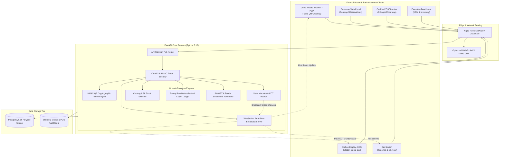

# PUBLIQ — System Architecture Blueprint

## Architectural Overview

PUBLIQ utilizes a modern, decoupled client-server architecture engineered for high availability, low latency, and real-time operational synchronization.

---

## 1. Frontend Architecture (Next.js 14 & React 18)

- **Framework:** Next.js 14 with App Router (`src/app`).
- **Styling Engine:** Tailwind CSS with custom Midnight Navy (`#0B1528`), Radiant Cyan (`#38BDF8`), and Warm Gold (`#D4AF37`) luxury design language.
- **State Management:**
  - `TableSessionContext`: Persists cryptographic in-restaurant table session, table number, dining area, and validation state across all navigation.
  - `CartContext`: Client-side cart persistence, instant price calculations, and takeaway/dine-in modes.
- **Real-Time Integration:** Native WebSockets subscribing to `/api/v1/ws/orders/{order_id}` and `/api/v1/ws/kds/tickets`.

---

## 2. Backend Architecture (FastAPI & Python 3.12)

- **Framework:** FastAPI with asynchronous ASGI execution (`uvicorn`).
- **Data Validation:** Pydantic v2 schemas providing strict compile-time and runtime request/response coercion.
- **Object Relational Mapping (ORM):** SQLAlchemy 2.0 with declarative models, connection pooling (`pool_pre_ping=True`), and automatic SQLite/PostgreSQL URL normalization.
- **Modularity:** Layered domain architecture:
  - `app/api/v1/endpoints/`: Thin controller route definitions.
  - `app/models/`: Normalized database entities.
  - `app/schemas/`: DTOs (Data Transfer Objects).
  - `app/services/`: Core business logic (pricing, inventory deductions, tax breakdown).
  - `app/core/`: Security, token generation, and database session lifecycle.

---

## 3. Cryptographic QR Deep-Link Architecture

When a guest scans a table QR plaque:
1. Camera intercepts universal URL: `https://publiq.com/order/<hmac_token>` (or `publiq://order/<hmac_token>` via Android Asset Links / Apple Universal Links).
2. The frontend calls `/api/v1/qr-sessions/validate` passing the token.
3. Backend validates HMAC-SHA256 signature against private `QR_TOKEN_SALT`.
4. Decodes payload: `{"oid": "outlet_id", "tid": "table_id", "tnum": "04"}`.
5. Locks the validated session into `TableSessionContext`, rendering the table indicator across the entire ordering flow.
