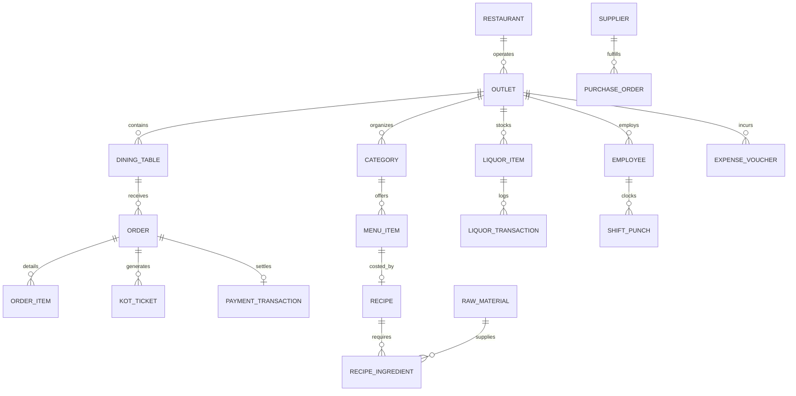

# PUBLIQ — Database Architecture & Entity Relationships

The data layer is modeled using **SQLAlchemy 2.0**, supporting both **PostgreSQL 16** (production) and **SQLite 3** (local zero-dependency development).

---

## 1. Entity-Relationship Diagram (ERD)

---

## 2. Core Entity Descriptions

### `Restaurant` & `Outlet`
- **Purpose:** Represents the top-level hospitality enterprise (`PUBLIQ`) and multi-location outlets (e.g., Indiranagar Flagship).
- **Key Fields:** `id`, `name`, `brand_tagline`, `logo_url`, `currency`, `opening_float`, `is_active`.

### `DiningTable`
- **Purpose:** Physical tables across seating zones (Blossom Dining Hall, Resto-Bar Counter, Terrace Cabana).
- **Key Fields:** `id`, `outlet_id`, `table_number`, `dining_area`, `capacity`, `qr_token`, `universal_link`, `is_occupied`, `scan_count`.

### `Category` & `MenuItem`
- **Purpose:** 17 specialized dining categories (Starters, Tandoor, Biryani, Main Course, Single Malts, Cocktails, Desserts).
- **Key Fields:** `id`, `name`, `slug`, `is_alcohol`, `base_price`, `is_veg`, `is_signature`, `is_available` (86 toggle).

### `Order` & `OrderItem`
- **Purpose:** Guest dining checks, itemized selections, cooking notes, and statutory tax breakdown.
- **Key Fields:** `id`, `order_number`, `table_id`, `status` (`PLACED`, `ACCEPTED`, `PREPARING`, `SERVED`, `SETTLED`), `subtotal`, `cgst_amount` (2.5%), `sgst_amount` (2.5%), `total_amount`.

### `LiquorItem` & `LiquorTransaction`
- **Purpose:** High-precision bottle inventory and per-milliliter cellar tracking.
- **Key Fields:** `id`, `brand_name`, `category`, `bottle_volume_ml`, `total_sealed_bottles`, `open_bottle_remaining_ml`, `pegs_available_30ml`, `cost_per_bottle`, `excise_code`.

### `RawMaterial` & `Recipe`
- **Purpose:** Kitchen pantry storage, batch unit rates, and automated food costing engine.
- **Key Fields:** `id`, `sku`, `name`, `unit` (`KG`, `L`), `current_stock`, `min_reorder_level`, `cost_per_unit`.

### `Employee` & `ExpenseVoucher`
- **Purpose:** Governance, biometric staff shifts, and general ledger operational outflows.
- **Key Fields:** `name`, `role`, `pin_code`, `salary`, `attendance_today`, `voucher_amount`, `payment_mode`, `approved_by`.
