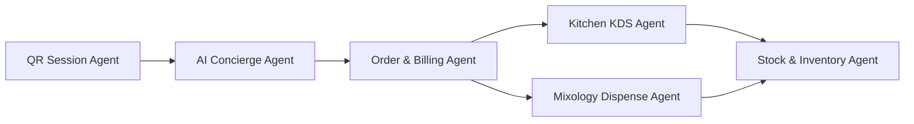

# Autonomous Agent Documentation & Roles

## Overview

KICK BUNK employs specialized operational agents that coordinate guest interactions, order progression, kitchen preparation, and financial reconciliation.

---

## 1. Cryptographic QR Security Agent

- **Component:** `backend/app/services/qr_service.py` & `backend/app/core/security.py`
- **Objective:** Generates and validates tamper-proof table dining sessions.
- **Processing Logic:**
  - Encodes payload: `{"oid": outlet_id, "tbl": table_number, "ts": timestamp}`.
  - Computes HMAC-SHA256 signature using `settings.QR_TOKEN_SALT`.
  - Rejects tokens with altered payloads or invalid signatures with `400 Bad Request`.
- **Integrations:** Next.js table order listener (`/order/[token]`).

---

## 2. AI Concierge & Pairing Agent

- **Component:** `backend/app/api/v1/endpoints/experience.py` (`/experience/ai/chat`)
- **Objective:** Assisting dining guests with food recommendations, cocktail pairings, and dietary allergen queries.
- **Processing Logic:**
  - Ingests natural language guest messages.
  - Cross-references current menu database and availability (filtering out 86'd items).
  - Generates sensory food and drink pairings based on culinary profiles (e.g. Smoky tandoor kebabs with bourbon cocktails).

---

## 3. Kitchen KDS Dispatch Agent

- **Component:** `backend/app/api/v1/endpoints/admin_operations.py` & `frontend/src/app/admin/kot/page.tsx`
- **Objective:** Manages the order lifecycle across kitchen stations.
- **Workflow Stages:**
  - `PLACED`: New ticket queued from guest QR or POS.
  - `ACCEPTED`: Chef acknowledged and printed to station.
  - `PREPARING`: Live cooking in clay oven or curry pans.
  - `READY`: Runner notification for table service.
- **Rush Handling:** Flags tickets exceeding station preparation thresholds with priority warnings.

---

## 4. Bar Mixology & Peg Dispense Agent

- **Component:** `backend/app/api/v1/endpoints/admin_operations.py` & `backend/app/api/v1/endpoints/admin_inventory.py`
- **Objective:** Accurately accounts for bottle decanting and single malt pours.
- **Processing Logic:**
  - Routes drink orders from tables directly to the bar counter.
  - Automatically calculates 30ml and 60ml portions.
  - Decants sealed bottles into the bar rail and records open bottle volume levels.

---

## 5. POS Outbox & GST Billing Engine

- **Component:** `backend/app/services/payment_service.py` & `backend/app/api/v1/endpoints/admin_reports.py`
- **Objective:** Compliant billing with Indian Restaurant GST laws.
- **Tax Rules:**
  - 2.5% Central GST (CGST)
  - 2.5% State GST (SGST)
  - Total: 5% Non-ITC Hospitality Rate under SAC 996331.
  - Supports split payment tenders: UPI (GPay/PhonePe), Credit/Debit Cards, Cash.
