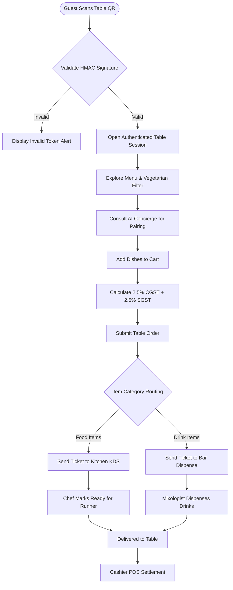

# Operational Workflows & Lifecycle Documentation

## Complete Guest Dine-In Journey

## 1. Cryptographic QR Lifecycle
1. The administrator generates a QR code for a table in `/admin/qr` specifying Table Number (e.g., Table 08) and Section (e.g., Garden Cabanas).
2. The system hashes the table ID, outlet ID, and timestamp using `QR_TOKEN_SALT`.
3. When scanned, the token is verified without requiring guest login, binding the device to that table.

## 2. Kitchen KDS Bump Workflow
1. Tickets appear in `/admin/kot` in the `PLACED` queue.
2. Clicking **Accept Ticket & Print KOT** advances the status to `ACCEPTED`.
3. Clicking **Mark Cooking** advances the ticket to `PREPARING` and displays elapsed cooking minutes.
4. Clicking **Mark Cooked & Ready** notifies the floor runner and finishes the ticket cycle.

## 3. Stock Auto-Deduction Lifecycle
1. Each dish is mapped to a recipe standard in `/admin/recipes`.
2. When a ticket is marked `ACCEPTED`, the raw ingredient quantities (e.g., chicken drumsticks, cream, ghee) are deducted from the raw materials inventory.
3. When beverage tickets are dispensed, exact milliliter volumes are deducted from open bottles in `/admin/inventory/liquor`.
